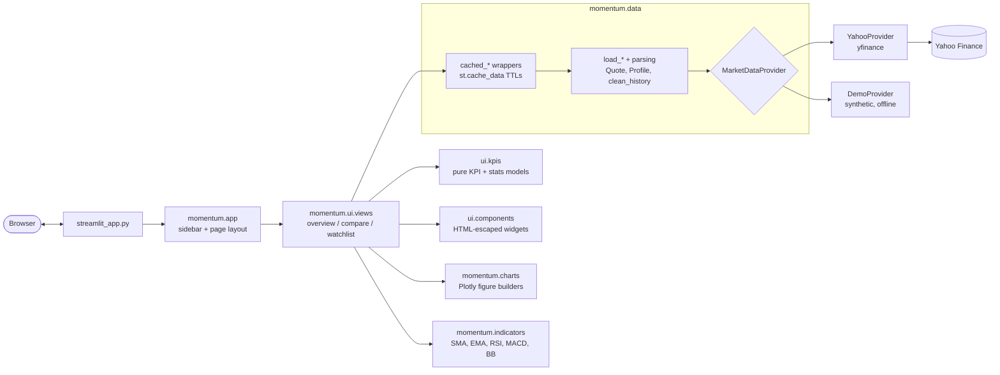

# Momentum

[](https://github.com/Arya-9989/Momentum-Live-Stock-Tracker/actions/workflows/ci.yml)

[](LICENSE)

A fast, mobile-friendly Streamlit dashboard for global stocks, indices, ETFs, FX and crypto.
Type any Yahoo Finance symbol (`AAPL`, `LT.NS`, `VOD.L`, `^GSPC`, `BTC-USD`) to get candlestick
charts with technical indicators, key statistics, a company profile, multi-symbol comparison and
a watchlist. All of it is backed by a typed, tested data layer that degrades gracefully when Yahoo
misbehaves.


<table>
  <tr>
    <td width="66%"></td>
    <td width="34%"></td>
  </tr>
</table>

| Compare | Watchlist |
| --- | --- |
|  |  |

<sub>Screenshots are of the Docker image serving live Yahoo Finance data, captured with
<code>scripts/capture_screenshots.py</code>.</sub>

## Features

- **Any Yahoo symbol, correctly labelled.** Prices carry their own currency (`$`, `₹`, `€`, `£` and
  others). London listings are shown in pence (`120.50p`) as the LSE quotes
  them, with market cap in pounds, and index levels are shown as points, not dollars. The
  header shows exchange, instrument type and market state (open, pre-market, after hours or
  closed).
- **Candlestick or line charts** with volume, for ten ranges (1D to Max) and the bar intervals
  Yahoo actually supports for each range (for example, 1-minute bars only for 1D).
  Weekends, exchange holidays and overnight gaps are removed from the axis, and times are shown in
  the exchange's local time.
- **Technical indicators:** SMA 20/50/200, EMA 12/26, Bollinger Bands (20, 2), RSI (14, Wilder)
  and MACD (12, 26, 9). Daily-and-longer charts fetch extra history so moving averages are
  already defined at the left edge of the chart.
- **KPI cards** for the range return, market cap, P/E (TTM), volume vs. 3-month average and
  annualised volatility. Indices, FX and crypto get day high/low and max drawdown instead.
- **Key statistics** with day and 52-week range bars, plus a company profile (sector, industry,
  employees, website, business summary).
- **Compare** up to six symbols as cumulative % return from a common start, with return,
  volatility and max-drawdown columns.
- **Watchlist** of up to twelve symbols, each with price, day change, a 1-month trend sparkline,
  52-week position and range, market cap and P/E. Select a row to open that symbol.
- **CSV export** of the visible prices plus indicators, the comparison and the watchlist.
- **Shareable URLs.** Symbol, range, tab and demo mode live in the query string, e.g.
  `?ticker=LT.NS&range=1Y&view=Compare`.
- **Light and dark themes** that follow the viewer's OS setting, and a layout that reflows for
  phones.
- **Demo mode** with deterministic synthetic data, for offline use and tests. It is clearly
  labelled in the UI whenever it is on.

## Architecture



- `data`: providers translate every upstream failure (unknown symbol, rate limit, network error)
  into one of three `DataError` types whose messages are safe to show to users. Parsing is pure.
  Batch loaders fetch in parallel and isolate per-symbol failures.
- `indicators`, `charts`, `formatting` and `ui.kpis` are pure functions of DataFrames and
  dataclasses, with no Streamlit and no I/O, so they are unit-tested directly.
- `ui` is the only layer that calls Streamlit widgets.

## Quickstart

### Docker

```bash
docker build -t momentum .
docker run --rm -p 8501:8501 momentum
# offline / synthetic data:
docker run --rm -p 8501:8501 -e MOMENTUM_DEMO=1 momentum
```

Open <http://localhost:8501>. The image is multi-stage, runs as a non-root user and has a
`HEALTHCHECK` on Streamlit's `/_stcore/health` endpoint.

### Local (uv)

```bash
uv sync                      # Python 3.12 + locked dependencies + dev tools
uv run streamlit run streamlit_app.py
```

### Streamlit Community Cloud

1. Fork this repository and click **Create app** on [share.streamlit.io](https://share.streamlit.io).
2. Set **Main file path** to `streamlit_app.py`, and choose Python 3.12 under *Advanced settings*.
3. Deploy. Pinned dependencies come from `requirements.txt` (generated from `uv.lock`), and the
   theme from `.streamlit/config.toml`. The entrypoint adds `src/` to the import path when the
   package itself is not installed, so no extra setup is needed.

## Configuration

| Setting | Where | Default | Effect |
| --- | --- | --- | --- |
| `MOMENTUM_DEMO` | env var | `0` | `1`/`true` starts with synthetic demo data |
| `?demo=true` | URL | off | Same, per session (also a sidebar toggle) |
| `?ticker=`, `?range=`, `?view=` | URL | `AAPL`, `6M`, `Overview` | Deep links |
| Theme, server options | `.streamlit/config.toml` | | Light/dark palettes, font, headless server |
| Cache TTLs, defaults | `src/momentum/config.py` | quotes 60 s, intraday 60 s, daily 15 min, profile 24 h | |

Any `STREAMLIT_*` environment variable (for example `STREAMLIT_SERVER_PORT`) works as usual.
No API keys or secrets are required.

## Testing and quality

```bash
uv run pytest --cov          # unit + AppTest smoke tests, no network access
uv run ruff check . && uv run ruff format --check .
uv run mypy                  # strict mode
```

- **Indicators** are checked against published reference values: RSI reproduces the StockCharts
  ChartSchool worksheet to the cent, and MACD, EMA and Bollinger Bands are checked against
  hand-computed recursions.
- **Data layer** tests replace `yfinance.Ticker` with fakes covering empty frames, `Infinity`
  values, rate limits, connection errors, timezone handling, partial batch failures and the
  rule that failures are never cached.
- **Formatting** tests cover currencies, pence-quoted listings, indices, compact numbers and
  missing values.
- **App smoke tests** run the real script with `streamlit.testing.v1.AppTest` (demo data, network
  stubbed to fail), covering each tab, URL deep links, invalid symbols and the
  network-failure path.

CI (`.github/workflows/ci.yml`) runs lint, format check, mypy, tests with coverage, a check that
`requirements.txt` matches `uv.lock`, and a Docker build whose container must report healthy and
run as non-root.

To refresh the README screenshots, start the app and run
`uv run --group screenshots python scripts/capture_screenshots.py` (add `--demo` for synthetic data).

## Project structure

```text
.
├── streamlit_app.py           # thin entrypoint (local, Docker, Streamlit Cloud)
├── src/momentum/
│   ├── app.py                 # page composition and sidebar
│   ├── config.py              # ranges, valid intervals, warm-up, TTLs, palette
│   ├── data.py                # providers, parsing, loaders, cached API
│   ├── demo.py                # deterministic synthetic provider
│   ├── indicators.py          # SMA, EMA, RSI, MACD, Bollinger, returns, drawdown
│   ├── charts.py              # Plotly price/indicator and comparison figures
│   ├── formatting.py          # currency-aware number formatting
│   └── ui/                    # views, components, KPI models, styles.css
├── tests/                     # pytest suite (no network)
├── scripts/capture_screenshots.py
├── .streamlit/config.toml     # light + dark theme
├── Dockerfile, .dockerignore
├── pyproject.toml, uv.lock, requirements.txt
└── .github/workflows/ci.yml
```

## Design decisions

- **A provider seam instead of calling yfinance everywhere.** The UI depends on
  `MarketDataProvider`, so demo data, tests and a future paid API are drop-in replacements.
- **Errors are values at the boundary.** yfinance raises a mix of its own, `curl_cffi` and
  built-in exceptions. They are translated once into `NoDataError`, `DataSourceError` or
  `InvalidSymbolError`, and the UI only shows those messages.
- **Cache successes only.** `st.cache_data` does not memoise exceptions, so a transient outage is
  retried on the next interaction instead of being pinned for the TTL. TTLs are shorter for
  intraday bars than for daily bars.
- **Indicator warm-up.** Showing SMA 50 on a 6-month chart needs about 50 bars before the first
  visible one. Daily-and-longer ranges fetch a longer period, compute indicators on it and trim
  the result. Intraday ranges don't, because Yahoo caps intraday look-back.
- **Exchange-local time.** Bars are converted to naive exchange-local timestamps, so a 09:15 NSE
  open reads 09:15 for every viewer, and overnight gaps can be removed from the axis.
- **Wilder RSI and population-σ Bollinger Bands**, matching what charting platforms display
  rather than a naive rolling mean or sample standard deviation.
- **Escaping.** All Yahoo-provided text (names, summaries, URLs) is HTML-escaped before it goes
  into custom markup.

## Data source and disclaimer

Market data comes from Yahoo Finance through [yfinance](https://github.com/ranaroussi/yfinance), an
**unofficial**, community-maintained library that is not affiliated with or endorsed by Yahoo.
Data may be delayed, incomplete or briefly unavailable, and Yahoo can rate-limit requests. Use is
subject to Yahoo's terms. This project is for education and personal use. **It is not financial
advice.**

## Roadmap (future work)

These features are not implemented yet:

- Persist the watchlist per user (it currently lives in the browser session).
- Price and indicator alerts.
- Portfolio view with holdings, cost basis and P&L.
- A second data provider (e.g. a licensed API) behind the existing `MarketDataProvider` interface.
- Fundamentals tab (income statement, balance sheet, dividends).

## License

[MIT](LICENSE) © Arya Mahindrakar
